# PCIe互联下Host/Device内存共享访问综述

## 第一章　PCIe 基本能力介绍

Host 与 Device 共享一段内存，是指双方能够按约定访问同一份存储。存储可以位于主机 DRAM，也可以位于设备的 SRAM、DDR 或 HBM。一次访问需要回答三个问题：**存储位于哪里？谁发起 PCIe 请求？谁在什么时候可以使用数据？** 这三个问题分别决定地址如何配置、线上出现什么事务，以及软件怎样同步。

本文中的 Host 是主机，RC（Root Complex，根复合体）连接主机内存系统与 PCIe 层级，EP（Endpoint，端点）是网卡、FPGA 或 NPU 等设备。工程资料中的“直通访问”有两种语境：CPU 直接读写设备暴露的窗口，或者设备侧计算单元直接读写已映射的 Host 内存。本文用“谁访问谁”区分两者。显式 DMA 的方向则按**有效数据**标记，例如 H2D 表示数据从 Host 到 Device。[PCIe 基础规范，§1.3、§2.1][spec]

### 1.1　Bus Master DMA：端点主动发起内存事务

网卡收包时，驱动先给网卡一段可写的主机缓冲区。网络数据到达后，网卡自行发出 PCIe 写请求，将数据写入缓冲区。这里的 **Bus Master** 指网卡能够充当请求方（Requester）；**DMA** 指设备可以在 CPU 准备好资源后自行完成对内存的访问。端点功能的 PCI Command 寄存器中，**BME（Bus Master Enable，bit 2）** 控制其主动发起普通内存请求的能力。BME 置位之后，具体访问地址、长度和启动时机仍由设备任务决定。[端点 Command 寄存器][command] · [Linux PCI 驱动指南][pci]

显式 DMA 引擎通常接受源地址、目的地址和长度。高吞吐设备可使用描述符队列，既可批量取任务，也可把一个大任务拆成多笔 PCIe 事务。驱动负责准备 DMA 地址、提交任务并处理完成通知。计算核直接访问映射内存时，其访存单元也可以经端点产生同类请求；这种编程方式由计算指令触发访问，应用无需为每次读取单独提交拷贝描述符。[AMD QDMA 队列设计][qdma] · [CANN 主机内存注册接口][cann]

**图 1　端点作为请求方时，读和写有不同的数据方向**

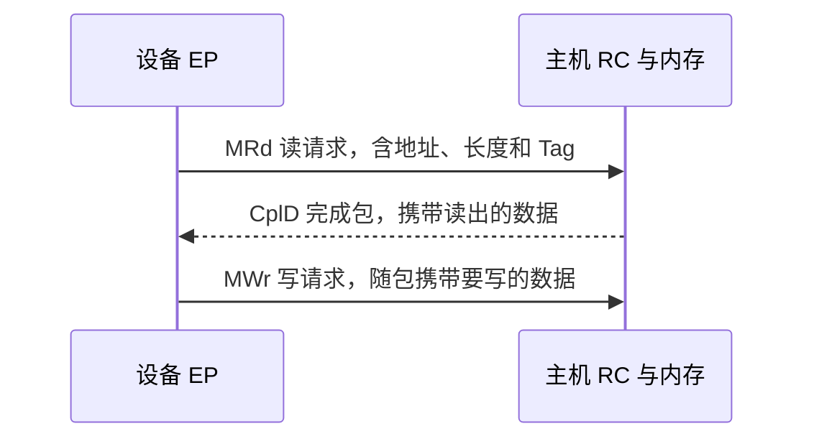

**MRd**（Memory Read）是需要完成包的读请求。成功时，主机以一个或多个 **CplD**（Completion with Data）返回数据。完成包按 Requester ID 路由回设备，设备用 Tag 匹配尚未完成的读取。普通 **MWr**（Memory Write）是 Posted Write，事务层没有逐笔成功完成包。驱动判断一整项 DMA 任务能否交付，应依据设备定义的完成状态和同步语义。[PCIe 基础规范，§2.2.4、§2.2.6、§2.2.9][spec]

### 1.2　PCIe BAR：让外部访问设备资源

**BAR（Base Address Register，基址寄存器）** 位于 PCI 功能的配置空间。对内存 BAR，设备声明所需窗口大小和属性，固件或操作系统在枚举、资源分配时为窗口分配 PCIe 总线地址，并配置沿途的桥窗口。端点的 **MSE（Memory Space Enable，Command bit 1）** 允许设备响应相应的内存空间访问。驱动映射 BAR 后，CPU 对该映射执行 MMIO 读写，RC 将其转换为 PCIe 内存请求。[Linux DMA 指南中的 CPU 到 BAR 地址图][dma] · [端点 Command 寄存器][command]

例如，设备可以用 BAR0 暴露控制寄存器，用 BAR2 暴露 64 KiB 板载 RAM。CPU 写 BAR0 中的门铃，效果是通知设备开始处理任务；CPU 写 BAR2，效果是改变板载 RAM 中的数据。两者在线路上都可能是 MWr，但目标硬件的行为不同。访问窗口内第 `0x120` 字节处，需要先取得操作系统映射的 CPU 侧 MMIO 地址，再加偏移；主机侧 MMIO 地址和 PCIe 总线地址可能不同。[Linux 设备 I/O 访问接口][mmio]

### 1.3　PCIe TX-ATU：将本地访问送往远端地址

ATU 是地址转换单元（Address Translation Unit）。本文将控制器的**出站地址转换**记为 TX-ATU，方向以当前控制器为参照。采用窗口转换的实现通常配置本地窗口基址、长度或上界、PCIe 目标基址、事务类型和使能位。匹配后按窗口内偏移换算，典型关系为 `PCIe 地址 = PCIe 目标基址 +（本地访问地址 − 本地窗口基址）`。设备通过这一窗口读写远端资源时，本地窗口地址表示一个访问入口，数据实际存放在远端。[Linux PCI Endpoint 出站映射接口][ep] · [AMD 控制器地址转换实例][atu]

例如 A 的出站窗口从 `0x4000_0000` 开始，映射到 PCIe 地址 `0x9000_0000`。A 的片上发起者写 `0x4000_0120`，PCIe 包中的地址就是 `0x9000_0120`。若某个 DMA 引擎的描述符直接接受已映射的 PCIe DMA 地址，则应按该引擎接口填写；不能看到一个出站请求就推定软件还要配置第二个转换窗口。控制器的寄存器布局、对齐要求和旁路能力均依实现而定。[AMD H2C DMA 引擎][h2c] · [Linux DMA 地址模型][dma]

### 1.4　PCIe RX-ATU：将入站请求送到本地资源

**RX-ATU** 指控制器的入站地址转换。EP 的常见配置是选择某个 BAR 作为匹配条件，指定片内目标基址。请求命中该 BAR 后，控制器保留窗口内偏移，将访问送往本地地址。有的控制器支持直接按地址范围匹配，有的硬件把 BAR 命中信号和偏移交给设备逻辑解码。BAR 定义对外窗口，RX-ATU 或等效逻辑决定窗口后面接哪块资源。[AMD 入站 ATU 的匹配模式][atu] · [Linux PCI Endpoint 的 BAR 配置][ep]

**图 2　同一偏移在三个地址空间中的位置（以 A 访问 B 为例）**

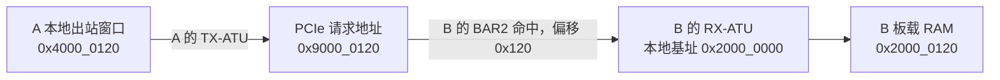

读回来的 CplD 虽然也从端点的接收链路进入，但它携带原请求的身份。端点按未完成事务匹配数据。只有收到一笔以本设备资源为目标的新内存请求，才沿 BAR 和入站地址解码路径寻找落点。[PCIe 基础规范，§2.2.4、§2.3][spec]

### 1.5　PCIe P2P 功能介绍

#### 1.5.1　P2P 的含义：由一个端点访问另一个端点

**P2P（Peer-to-Peer，对等访问）** 是指 PCIe 端点 A 作为请求方，直接访问另一个端点 B 对外暴露的资源。例如，网卡把收到的数据写入加速卡的板载内存，或者一张 NPU 卡读取另一张卡的计算结果。这里的“直接”表示业务数据无需先写入 Host DRAM、再由另一笔传输搬到目标卡；Host 仍可以负责枚举、地址分配、映射建立和任务提交。[Linux PCI P2P DMA 支持][p2p]

P2P 使用 PCIe 已有的内存事务和路由机制，并不存在一种专门叫“P2P 数据包”的基本内存事务。目标是 Host 内存时，请求最终由主机内存系统处理；目标是另一端点的内存窗口时，请求被送往该端点。两者都可以使用 MRd 和 MWr，区别在于目标地址、路由和资源归属。[PCIe 基础规范，§1.3、§2.1、§2.2][spec]

#### 1.5.2　拓扑与路由：同属一台 Host 并不保证能够互访

**图 3　同一交换机下的 P2P：Host 建立访问条件，业务数据在端点间传输**

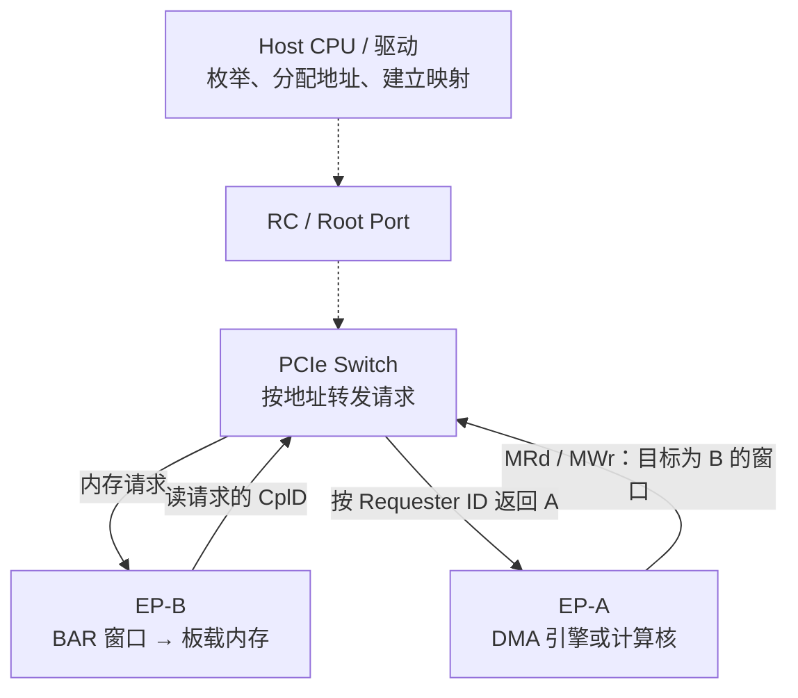

图中虚线表示 Host 所在的上行连接及配置路径，实线表示允许交换机本地转发时的业务事务。A 与 B 位于同一交换机下时，请求可以不经过 Root Port，但实际路径受 **ACS（Access Control Services，访问控制服务）** 等配置影响：某些配置会把对等请求重定向到上游。若两张卡分属不同 Root Port，或请求被重定向到主桥，则还需平台支持相应转发；PCIe 并不保证任意主桥、任意层级域之间均可 P2P。应同时确认拓扑、平台能力和操作系统支持。[Linux PCI P2P 路由限制][p2p]

因此，“不借用 Host DRAM 中转”和“不经过 RC”是不同条件。支持跨 Root Port 转发的平台，可能让事务经过 RC 内部互连后到达另一张卡，但不把数据暂存到 Host DRAM。

#### 1.5.3　BAR、TX-ATU 与 RX-ATU 怎样协作

以下按 **A 主动访问 B** 说明角色。BAR 和 ATU 作用于地址可达性；是否由队列 DMA 或计算核触发请求，不改变请求方与目标方的区分。[Linux PCI Endpoint 映射接口][ep] · [PCIe 基础规范，§2.2、§2.3][spec]

| 环节 | 所需能力或配置 | 作用 |
|---|---|---|
| A 发起请求 | A 的 BME 使能；驱动为 A 取得可用的对等资源地址或映射 | 允许 A 主动发出 MRd/MWr，并确定访问目标 |
| A 形成出站地址 | A 的 TX-ATU 或等效出站逻辑 | 若 A 使用片内出站窗口，将其地址换算为指向 B 的 PCIe 地址；直接接受已映射 DMA 地址的引擎按自身接口配置 |
| 交换机或平台转发 | 桥地址窗口、路由及 ACS 等配置允许该路径 | 将请求送往 B 所在端口 |
| B 接受内存请求 | B 的内存 BAR 和 MSE 使能 | 识别请求落在 B 对外暴露的地址窗口内 |
| B 找到实际存储 | B 的 RX-ATU 或等效入站解码 | 将 BAR 内偏移对应到 B 的 SRAM、DDR 或 HBM 等资源 |
| B 返回读取结果 | CplD 路由及 A 的未完成请求匹配 | 按 Requester ID 返回 A，再用 Tag 对应原读操作 |

沿用图 2 的地址示例，A 访问本地出站窗口 `0x4000_0120`，经出站转换形成 `0x9000_0120`；该地址命中 B 的 BAR2，再经入站映射访问 B 的 `0x2000_0120`。**A 的 TX-ATU 与 B 的 RX-ATU 分处请求路径两端**，不是要求同一张卡必须同时为这笔单向请求配置两者。ATU 是具体控制器的实现方式，PCIe 协议不要求所有设备都具有同名、可编程的 ATU 模块。[Linux Endpoint 出站映射与 BAR 配置][ep] · [AMD 入站 ATU 示例][atu]

A 写 B 时，MWr 随包携带数据，普通写请求没有逐笔成功完成包。A 读 B 时，A 发送 MRd，B 返回一个或多个 CplD；返回的数据由 A 匹配到原读操作，**无需仅为接收该完成包再暴露 A 的 BAR**。若改为 B 主动读取 A 的内存，则 A 成为目标方，才需要为 A 的被访问资源建立对外窗口。[PCIe 基础规范，§2.2.4、§2.2.6、§2.2.9][spec]

#### 1.5.4　P2P DMA 拷贝与 P2P 共享访问

同一条可用的 P2P 路径，可以服务于不同的软件操作：

| 软件方式 | 触发访问的单元 | 应用看到的行为 | 额外条件 |
|---|---|---|---|
| P2P DMA 拷贝 | DMA 引擎 | 提交源地址、目的地址和长度，等待一段数据搬运完成 | 引擎支持相应对等地址，驱动或运行时能够建立有效映射 |
| P2P 共享内存访问 | 设备计算核的访存单元 | 使用设备可见指针，按需读取或写入远端内存 | 计算核能够访问出站路径，运行时支持把对端资源映射到其地址空间 |

两种方式在链路上都可产生 MRd/MWr，但“DMA 引擎能拷贝”不等于“计算核能解引用对端地址”。应用必须使用驱动或运行时返回的本设备可见映射，不能把 B 的本地指针或 Host 映射 BAR 得到的 CPU 指针直接交给 A。普通 PCIe P2P 也不自动提供两卡缓存一致性；生产者写完数据后如何发布完成、消费者何时能读取，以及是否需要缓存维护，都要遵守平台和运行时的同步规则。[Linux DMA 地址模型与内存顺序][dma] · [CANN 对等访问接口][asc-peer] · [CANN 跨设备内存导入接口][asc-import]

第 1.6 节先以 Host 与 Device 为例展开请求方向和 ATU 配置；第 1.7 节再具体说明多设备 P2P 的映射建立、推送与拉取，以及共享队列的数据流。

### 1.6　Host 与 Device 之间的四种访问方式

以下以设备 B 为例。B 的 BAR0 是控制区；BAR2 是 64 KiB 数据窗口，PCIe 基址为 `0x9000_0000`，映射到板载 RAM 基址 `0x2000_0000`。另有一页 Host DRAM，假设启用主机 IOMMU 翻译，设备 B 得到的 DMA 地址为 `0x8000_0000`（IOVA），对应主机物理页 `0x3400_0000`。数值是教学示例。下文使用页内偏移 `0x120`，一次传送 64 字节。配置桥窗口、核准 DMA 映射和取得设备地址均由平台及驱动完成。[Linux DMA 地址映射指南][dma]

| 场景 | 由谁触发 | 承载数据的事务 | 数据到达哪里 |
|---|---|---|---|
| Host 提交 H2D DMA，卡上引擎拉取 | CPU 写门铃，B 的 DMA 引擎发读 | Host → B 的 CplD | B 的板载 RAM |
| Host 直接写设备窗口 | CPU 写映射的 BAR2 | Host → B 的 MWr | B 的板载 RAM |
| Device 用 DMA 写 Host | B 的 DMA 引擎执行任务 | B → Host 的 MWr | 已映射的 Host DRAM |
| Device 算子直接读 Host | B 的算子执行读操作 | Host → B 的 CplD | 算子使用读回的数据 |

**ATU 应配在哪一侧？** 以每一笔 MRd/MWr **请求**的起点和终点判断方向。即使载荷都是 Host → B，Host 主动写与 B 主动读也会使用不同的窗口。表中列出的是采用可编程 ATU 的控制器所需的映射。[Linux 主机控制器的地址转换说明](https://docs.kernel.org/PCI/controller/pci-controller-drivers.html) · [Linux Endpoint 映射接口][ep]

| 发出新请求的环节 | 出站侧（TX-ATU） | 入站侧（RX-ATU） |
|---|---|---|
| Host 写 B 的 BAR0 门铃、CPU 读写 BAR2，或 Host 侧 DMA 向 BAR2 推送 | **RC 侧**：若平台采用出站窗口，Host 本地 MMIO 范围应覆盖相应 PCIe BAR 地址的映射。通常由固件或主机控制器驱动在初始化时建立。 | **EP-B 侧**：BAR0 命中后指向门铃寄存器，BAR2 命中后指向板载 RAM。若其中某个 BAR 采用可编程翻译，由端点侧配置对应 RX 区域；硬连线解码的 BAR 可直接使用。 |
| B 取 Host 描述符、DMA 读写 Host 缓冲区，或算子直接读写 Host | **EP-B 侧**：片上发起者若访问本地出站窗口，须先建立该窗口到 Host DMA 地址范围的映射；直接接受已映射 DMA 地址的引擎按其接口编程。 | **RC 侧**：若主桥要求可编程入站窗口，平台须预先开放相应 DMA 地址范围。启用 IOMMU 时，驱动还要为 B 建立缓冲区的 DMA 映射和权限。主桥入站窗口与 IOMMU 页映射各有配置职责。 |
| 为先前的 MRd 返回 CplD | 完成包按 Requester ID 路由。 | 请求方用 Tag 匹配原读操作，无需为返回数据另配 BAR 或反向 ATU 窗口。 |

**配置时机。** RC 的主桥窗口通常随平台初始化配置；B 的 BAR 后端通常在端点初始化或资源重映射时配置。针对特定缓冲区的 DMA 映射和必要的出站窗口，则要在发门铃、提交 DMA 或启动算子**之前**有效，并保留到使用者完成。后续请求命中已有窗口时可复用它，无需每发一包重写寄存器。[Linux DMA 映射生命周期][dma] · [Linux Endpoint 出站映射接口][ep]

#### 1.6.1　Host 通过显式 DMA 向 Device 搬运数据

**配置。** 驱动启用 B 的 BME，准备 Host 源缓冲区，在 Linux 上按 `DMA_TO_DEVICE` 的方向建立映射。以卡上 DMA 引擎为例，描述符指定 Host 源 DMA 地址 `0x8000_0120`、卡内目的地址 `0x2000_0120` 和 64 字节长度。若采用主机内存描述符环，驱动还要初始化队列、保证描述符内容可见，再写 BAR0 门铃。这里门铃才需要 B 的 BAR；引擎向本卡 RAM 写入结果可直接走本地总线。[AMD H2C DMA 引擎][h2c] · [Linux DMA 映射与内存顺序][dma]

**图 4　Host 提交任务，卡上 DMA 主动拉取数据**

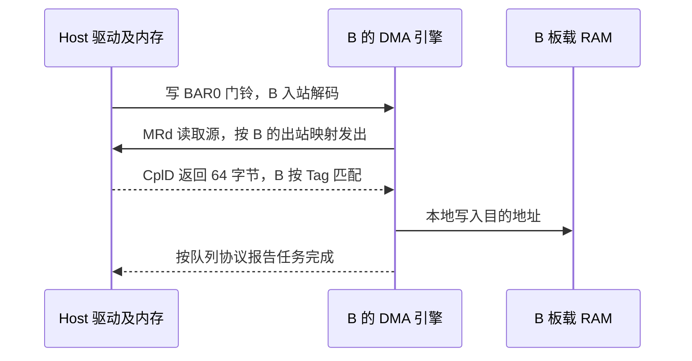

**门铃和载荷分别配置。** 写门铃前，RC 的出站 MMIO 映射及 B 的 BAR0 入站解码须已就绪。若卡上引擎通过 B 的 TX-ATU 取数，须在敲门铃前建立覆盖 Host 源地址 `0x8000_0120` 的出站窗口；若描述符环也在 Host，取描述符的路径同样要覆盖环的 DMA 地址。CplD 回卡后，引擎按描述符把数据写到卡内 `0x2000_0120`，此步是本地写，无需 B 的 BAR2/RX-ATU。待任务完成后，驱动才可复用或解除源缓冲区映射。[AMD H2C DMA 引擎][h2c] · [Linux DMA 映射][dma]

**变体：Host 侧 DMA 推送。** 若平台支持 Host DMA 引擎访问设备 MMIO 资源，源取主机内存，目的填对该引擎有效的 B 的 BAR2 资源地址。提交前须确保 **RC 出站映射覆盖 BAR2，B 的 BAR2 入站解码指向板载 RAM**。使用可编程窗口时，对应 RC 的 TX-ATU 和 B 的 RX-ATU。此时载荷在 Host 发出的 MWr 中，B 的 TX-ATU 不参与这笔写。[Linux DMA 地址模型][dma] · [PCIe 基础规范，§2.2.7][spec]

#### 1.6.2　Host 直接访问 Device 的共享窗口

**配置。** B 将板载 RAM 接到 BAR2 并设置入站映射，系统分配 BAR、配置桥窗口并启用 MSE。Host 驱动映射该资源，并按设备允许的宽度和内存属性访问它。比如驱动向偏移 `0x120` 写一个 32 位字段，Linux 内核中可使用适合该硬件的 MMIO 写访问器。窗口公开的范围和设备支持的访问粒度决定了 CPU 实际可用的区域。[Linux 设备 I/O 访问接口][mmio] · [Linux Endpoint 框架][ep]

**图 5　CPU 直接操作 B 的板载内存**

在本例采用 BAR Match 的实现中，B 侧 RX-ATU 的匹配条件为 BAR2，本地目标基址为 `0x2000_0000`。Host 驱动使用已映射的 BAR2 并加偏移，RC 复用平台的出站 MMIO 窗口。读和写共用这对地址映射；读操作返回 CplD 时，无需另配 B 的 TX-ATU。[入站 ATU 的 BAR 匹配模式][atu] · [PCIe 路由规则][spec]

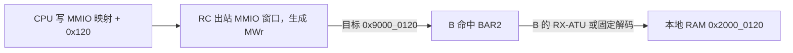

若改为读这个字段，RC 发 MRd，B 读取板载 RAM 并返回 CplD。普通 MMIO 写可以被缓冲；需要确认写已到达设备时，应遵循驱动和设备规定的顺序，适用时可读同一设备上安全可读的寄存器以排空先前的 posted write。设备何时可以消费整块缓冲区，则仍由双方约定的标志、门铃或队列协议决定。[Linux 关于 posted MMIO writes 的说明][mmio]

#### 1.6.3　Device 通过显式 DMA 写入 Host 内存

**配置。** Host 准备目的缓冲区，按 `DMA_FROM_DEVICE` 建立映射，将 DMA 地址交给 B，并启用 BME。任务指定卡内源 `0x2000_0120`、Host 目的 `0x8000_0120`、长度 64 字节。对直接接受总线地址的引擎，后一个地址直接作为目的；对从片上窗口发起访问的引擎，还要将相应出站窗口映射至该 Host DMA 地址范围。[AMD C2H DMA 引擎][c2h] · [Linux DMA 映射指南][dma]

**图 6　卡上 DMA 将结果推送到主机缓冲区**

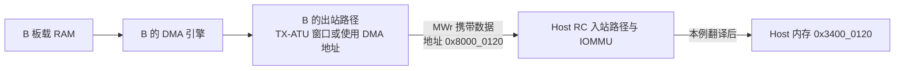

B 对这笔普通 MWr 收不到逐笔成功完成包。设备按传输协议在数据写之后发布完成状态，驱动通过完成队列、轮询或中断得知整项任务的进度。对流式 DMA 映射，CPU 取得缓冲区前还要按平台 DMA API 完成相应同步或解除映射。若任务改为 B 从 Host 拉取输入，则把载荷阶段改为 B 发 MRd、Host 返回 CplD。[PCIe 基础规范，§2.4][spec] · [Linux DMA 所有权与同步][dma]

#### 1.6.4　Device 算子直接访问 Host 共享内存

**配置。** 以昇腾 CANN 支持相应接口及算子的环境为例，Host 准备符合对齐要求的缓冲区，通过 `aclrtHostRegister` 注册映射并获得设备侧指针 `devPtr`，将其作为核函数参数。CPU 使用原始指针访问该缓冲区。对算子来说，读取哪几个字节由程序执行时计算的索引决定；注册本身并不搬运整块输入。[CANN 主机内存注册说明及产品支持表][cann]

**图 7　算子按需读 Host，完成包返回原读操作**

**谁配置出站路径。** 应用在启动算子前完成注册并使用返回的 `devPtr`。如果该控制器的核侧访问依赖 EP 出站窗口，运行时或底层驱动必须在该指针被使用前建立相应映射；若硬件已有直接出站路径，应用沿同一 API 使用。Host 侧仍须有可达的 DMA 地址范围及相应权限。B 自身的 BAR 和 RX-ATU 不用于定位该 Host 缓冲区，读响应也不需要反向窗口。[CANN 注册接口][cann] · [Linux DMA 地址模型][dma]

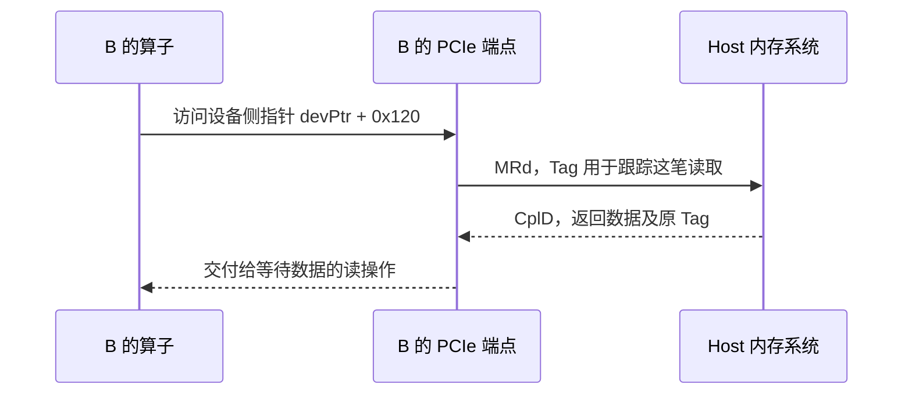

若映射可写且算子支持写，结果也可随 MWr 直接进入 Host 缓冲区。CPU 在算子访问期间应遵守缓冲区所有权约定，等待相关流或事件完成后再复用、注销和释放内存。CANN 保证的是设备侧指针的访问语义；该指针如何变成出站请求地址、某型号是否旁路 TX-ATU，属于控制器实现。实际案例中，昇腾 RecSDK 的换表算子使用 Host 共享队列组织表项换入换出，访问粒度和任务时机由算子决定。[CANN 注册接口][cann] · [昇腾 RecSDK 的 PCIe Through 样例][rec]

### 1.7　多个端点之间的 P2P DMA 与共享内存访问

**PCIe Peer-to-Peer（P2P）** 允许端点 A 直接向端点 B 暴露的 PCIe 资源发起内存事务。Host 负责枚举、分配 BAR、校验路由和协调驱动，业务载荷可以直接在两块卡之间传送。P2P 写使用 MWr，P2P 读使用 MRd 和 CplD，与访问 Host 内存使用相同的事务类型。能否成功取决于端点能力、地址映射和实际拓扑。[Linux PCI P2P DMA 文档][p2p]

**图 8　两个 EP 同属一台 Host 时，可能经过不同的路由**

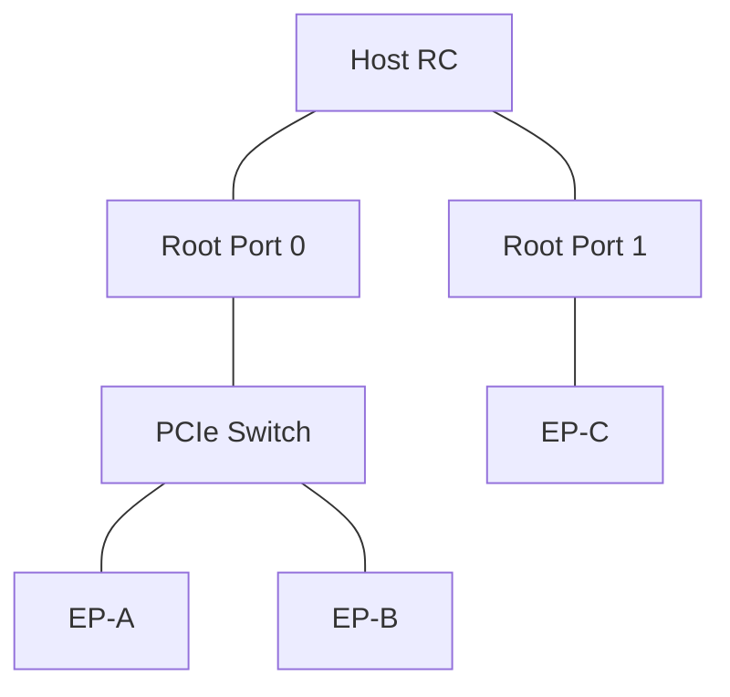

A 和 B 位于同一交换机下，若访问控制服务（ACS）允许本地转发，请求可走 **A → Switch → B**。若 ACS 重定向请求或完成包，流量可能被送往上游。A 和 C 分属不同 Root Port，是否支持跨层级转发取决于 RC、平台和驱动策略。经过 RC 转发与经 Host DRAM 暂存是两件事：前者仍可能是一次 P2P 访问，后者需要先写主机缓冲区、再由目标设备取走。Linux 的 P2P 框架会依据拓扑及已知平台支持情况判断可达性。[PCIe 基础规范，§1.3.1、§6.12][spec] · [Linux P2P 路由规则][p2p]

#### 1.7.1　建立 A 到 B 的对等映射

沿用图 2。假设平台允许本地转发，并且 A 看到的 B 的对等总线地址与 B 的 BAR2 总线地址一致。在采用可编程窗口的控制器上，可按以下顺序建立单向访问。

1. **B 提供存储。** B 的驱动或固件保留板载 RAM `0x2000_0000` 起的 64 KiB，配置 B 的 RX-ATU：命中 BAR2 时转到这段 RAM。系统给 B 的 BAR2 分配 `0x9000_0000` 并开启 B 的 MSE。
2. **Host 为 A 建立对等映射。** 驱动检查桥窗口、拓扑和 ACS 策略，取得对 **A** 有效的 peer DMA 地址，确认缓冲区可被 A 读或写。实际系统应使用平台提供的 peer 映射接口；CPU 用于访问 BAR 的虚拟指针不能直接填入 A 的描述符。
3. **A 建立出站路径。** 开启 A 的 BME。若 A 的片上发起者走窗口，配置 A 的 TX-ATU：将本地 `0x4000_0000` 起的 64 KiB 映射到 B 的 `0x9000_0000`；若 DMA 引擎原生接受 peer DMA 地址，直接按引擎接口填写。A 的本地出站窗口不需要作为 A 的 BAR 对外发布。
4. **保持映射有效。** 在对等访问结束前，B 保留这块内存及其 BAR 映射，A 保留访问所需的映射和权限。回收时先让双方停止新请求，等待已有访问按驱动协议完成，再撤销映射。[Linux P2P 资源提供与使用接口][p2p] · [AMD/Xilinx FPGA P2P 实例][xrt]

#### 1.7.2　同样把数据从 A 搬到 B，可以由 A 推，也可以由 B 拉

| 比较项目         | A 的 DMA 引擎推送                            | B 的 DMA 引擎拉取                                                   |
|:-----------------|:---------------------------------------------|:--------------------------------------------------------------------|
| 谁暴露 BAR 窗口  | **B** 暴露目的缓冲区，可写                   | **A** 暴露源缓冲区，可读                                            |
| 谁建立出站映射   | **A** 指向 B 的窗口                          | **B** 指向 A 的窗口                                                 |
| 首个载荷相关请求 | A → B：MWr，附带源数据                       | B → A：MRd，指定源地址                                              |
| 数据怎样到 B     | B 解码入站写，写入 B 本地 RAM                | A 从本地 RAM 取数，以 CplD 返回；B 匹配 Tag 后写入 B 本地 RAM       |
| 怎样通知消费者   | 按设备约定保序写入数据，再发布完成标志或门铃 | B 的 DMA 引擎收齐完成数据并写入本地目的缓冲区后，按队列协议报告完成 |

**图 9　相同的数据方向，两种相反的请求方向**

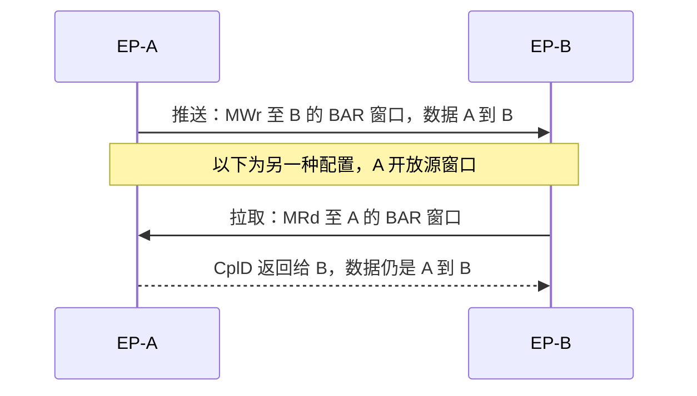

在推送例中，A 的 DMA 描述符包含 **A 本地源**与 **B 的 peer 目的地址**；B 的入站转换见图 2。在拉取例中，须反向建立 **B 的出站映射 → A 的 BAR → A 的入站映射**。反向映射承担的是读请求；返回的 CplD 在 B 通过 Tag 找到 DMA 上下文，本地目的 RAM 由 B 的描述符指定。设备若同时支持两种角色，可以双向建立映射。[PCIe 基础规范，§2.2.4、§2.3][spec] · [Linux P2P DMA][p2p]

#### 1.7.3　让 A 的计算核直接读写 B 的一块内存

设 B 将板载 RAM 的一部分用作队列，A 上的计算核可对出站窗口执行普通设备访存，并能获得运行时提供的对等映射。A 访问本地窗口偏移 `0x120` 时，**A 的 TX-ATU → B 的 BAR2 → B 的 RX-ATU** 仍沿图 2 工作。与显式 DMA 不同，A 的程序在需要某个字段时才执行读写，B 的计算单元则用本地地址访问同一份队列。硬件若仅允许 DMA 引擎使用对等地址，还需要额外的核侧可达性与运行时映射，才能提供这种编程方式。[AMD/Xilinx P2P 资源开放示例][xrt] · [Linux P2P 资源的映射与访问约束][p2p]

**图 10　单生产者、单消费者的共享队列示意**

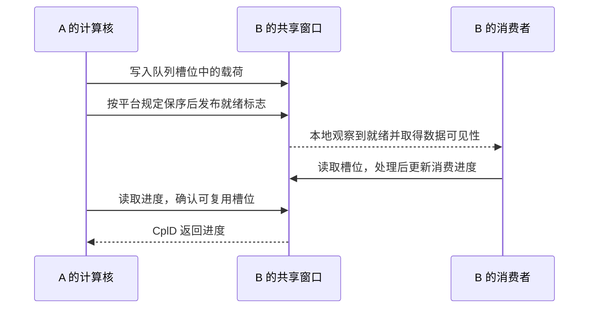

**共享地址只解决“访问哪里”，生产者与消费者还要约定“何时可读”。** 具体实现应明确窗口的内存属性、是否经过本地缓存、载荷与标志的写入顺序，以及消费者需要的屏障或缓存维护。普通 PCIe 内存读写本身不承诺两个端点的私有缓存保持一致。若目标窗口是设备寄存器，还要遵守规定的访问宽度和副作用语义，不能当作普通 RAM 使用。本例假定单生产者、单消费者，槽位所有权通过进度交还；多生产者场景还需要额外的仲裁机制。[Linux DMA 一致性与屏障说明][dma] · [Linux P2P 内存的 MMIO 属性][p2p]

从应用角度，大块且可批量提交的连续数据适合用 DMA 描述符组织；按索引访问远端数据或偶尔读取状态字段，更容易用共享窗口表达。比较性能时，应测量有效载荷、在途读请求数、往返等待、提交成本及同步成本。就读事务而言，两种写法只要最终发出相同的零散 MRd，就仍需承担相应的 PCIe 往返开销。[AMD QDMA 队列设计][qdma] · [PCIe 基础规范，§2.3][spec]

### 1.8　什么叫 PCIe DMA：从软件操作到链路事务

“队列＋门铃”描述了驱动向 DMA 引擎**提交一项搬运任务**的常见方式。在主机驱动和 IOMMU 的语境中，DMA 的含义更广：设备作为请求方，自主读写对它开放的主机内存，主机 CPU 无需逐笔搬运数据。到了 PCIe 事务层，普通内存访问使用 MRd（内存读）和 MWr（内存写）；协议没有用来区分“DMA 引擎触发”和“设备计算核访存触发”的 DMA 操作码。第 1.6 节所说的“显式 DMA”特指前一种编程方式。[Linux DMA 地址模型][dma] · [PCIe 基础规范，§2.1.1.1、§2.2.7][spec]

#### 1.8.1　拆开一次队列 DMA：门铃写了什么，载荷由谁搬

假设 CPU 要让卡 B 读取主机内存中的 64 字节。驱动先在主机描述符环填写源 DMA 地址、卡内目的地址和长度，再将新的队列尾指针写入 B 的 BAR 门铃寄存器。**门铃这笔 MWr 的载荷是尾指针**。随后，B 的 DMA 引擎读取新描述符，向主机源地址发出 MRd。**真正的 64 字节作为 CplD 的载荷从 Host 返回 B**，由 DMA 引擎写入卡内目的缓冲区。队列将多项任务排好，门铃告诉设备有新任务，描述符决定实际要搬哪段数据。[AMD QDMA 队列设计][qdma] · [H2C DMA 引擎][h2c]

**图 11　读取同一段主机内存的两种触发方式**

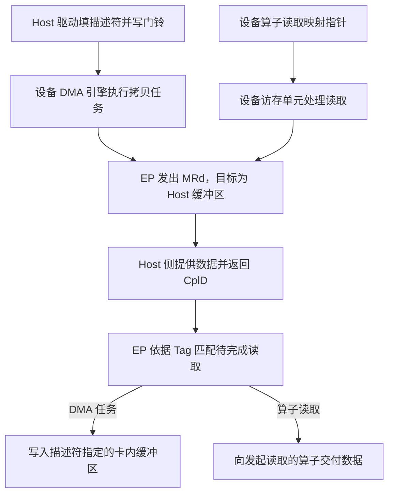

图中假设两条路径都实际访问 PCIe，且算子的读取未由本地缓存满足。DMA 任务可以一次触发多笔请求；算子的多次访存也可能合并为一笔请求。软件操作数与抓包看到的 TLP 数量可以不同。[PCIe 基础规范，§2.2、§2.3][spec]

#### 1.8.2　软件看到“直接读写内存”，是否算 DMA

| 软件操作 | 发起者和目标 | 链路上可见的事务 | 工程上的称呼 |
|:---|:---|:---|:---|
| Host CPU 对设备 BAR 执行 MMIO 读或写 | CPU 经 RC 访问 EP 资源 | RC 发 MRd 或 MWr | CPU 编程 I/O（PIO/MMIO）；即使写的是 DMA 引擎的门铃，这一笔也是 MMIO |
| 驱动提交拷贝，卡上 DMA 引擎读取 Host 缓冲区 | EP 访问 Host 内存 | EP 发 MRd，Host 回 CplD | 显式 DMA 拷贝，既有软件任务，也有设备主动访存 |
| NPU 算子执行类似 `x = mapped_host[i]` 的读操作 | EP 访问已注册的 Host 内存 | 若该读取跨链路，EP 发 MRd，Host 回 CplD | 主机侧属于设备发起的 DMA 访问；算子侧是映射内存读取 |
| Host CPU 读取自己的主机缓冲区，或设备核读取本卡 RAM | 发起者访问本地存储 | 在上述拓扑下无需 PCIe 内存事务 | 本地访存 |

因此，对“直接读写算不算 DMA”的回答取决于**谁执行这行代码、地址最终指向哪里**。以昇腾为例，Host 调用 `aclrtHostRegister` 令缓冲区对设备可访问，设备侧指针随后可以作为算子参数。注册建立映射；算子真正读取远端数据时，从主机视角才发生设备主动访问。称它为“设备对 Host 的 DMA 读”能准确表达主机侧行为；若写成“算子提交了一项 DMA 拷贝”，就额外假定了队列、目的缓冲区和拷贝完成语义，而这些都需要具体实现支持。[CANN 主机内存注册接口][cann] · [Linux 设备 MMIO 访问][mmio] · [Linux DMA 映射指南][dma]

#### 1.8.3　抓包能判定到哪一层

若抓到一笔 `MRd，Requester ID = B，地址 = 0x8000_0120，长度 = 16 DW`，并且 DMA 映射记录表明该地址属于 B 可读的 Host 缓冲区，就能判断 **B 正在读取 64 字节主机内存**。随后与该请求匹配的 CplD 说明读数据返回。要进一步区分“DMA 引擎取数”与“算子直接读取”，还要把事务关联到设备的 DMA 描述符、队列记录或算子执行轨迹。只看 MRd 的类型、地址和长度，无法区分图 11 中的两个起点。类似地，CplD 表明一笔读事务得到响应，整项拷贝或算子何时完成，应查对应的队列完成状态或运行时事件。[PCIe 基础规范，§2.2.6、§2.2.9、§2.3][spec] · [AMD QDMA 队列设计][qdma]

### 本章参考资料

- [PCI-SIG，《PCI Express Base Specification》规范入口][sig]。本文引用的章节编号对应 [Revision 6.2][spec]。
- [Linux 内核，PCI 设备驱动][pci]、[DMA 地址映射][dma]、[设备 I/O 访问][mmio]、[Endpoint 框架][ep]及 [PCI Peer-to-Peer DMA][p2p]。
- [AMD，PCIe 端点 Command 寄存器][command]、[入站 ATU 匹配模式][atu]及 [QDMA 队列设计][qdma]。
- [昇腾 CANN，Host 内存注册与设备可访问指针][cann]。具体接口支持范围以对应版本的产品表为准。
- [昇腾 RecSDK，PCIe Through 换表算子][rec]；[AMD/Xilinx XRT，PCIe Peer-to-Peer][xrt]。

## 第二章　PCIe 基本能力在昇腾上的应用

本章讨论两种远端内存访问。第一种由 NPU 算子通过 PCIe Through 读写 Host 内存，第二种由一张昇腾卡通过 PCIe P2P 访问另一张卡的板载内存。软件分别建立 Host 内存映射和对等设备映射，硬件最终使用 PCIe 内存事务完成访问。对于实际部署，需同时确认芯片型号、CANN 与驱动版本、所用算子的访存能力，以及两端的互联拓扑。[CANN Host 内存注册][cann] · [CANN 对等访问使能][asc-peer]

本章用图示描述协议和映射关系。图中的 ATU 表示出入站转换在路径上的作用位置；具体型号由哪些模块实现转换、是否旁路某一级 ATU，应以其控制器实现为准。应用通过 Runtime 申请和导入地址，由运行时及驱动维护映射。以下 API 片段用于说明调用次序，省略初始化、错误处理和失败回收，未作为完整硬件测试程序执行。

### 2.1　PCIe Through：Device 直接访问 Host 内存

#### 2.1.1　应用目标与地址归属

以推荐模型的 Embedding 查表为例。表存放在 Host DRAM，NPU 根据本批索引获取其中一些行。Host 将表缓冲区注册到当前 Device，取得设备可用的指针。算子按索引访问该指针时，读请求跨 PCIe 到达主机，返回的表项供设备计算使用。Host 保留原始指针用于自己的访问。注册关系令双方能够定位同一份存储，数据由实际读写操作传送。[CANN 注册接口及指针语义][cann]

**图 12　同一份 Host 数据的两个访问视角**

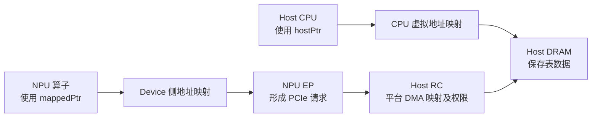

从第一章的分类看，这属于设备主动访问 Host 内存。端点需具备 Requester 能力及相应 BME 状态，Host 侧需允许该设备访问目标缓冲区。CANN 返回的设备指针属于算子可访问地址空间，将它放入核函数参数后，运行时和硬件完成后续地址处理。主机 IOMMU 开启翻译时，请求按平台配置转换到物理页；设备指针与线上地址之间的数值关系由映射决定。[Linux DMA 地址模型][dma]

#### 2.1.2　软件配置与内存生命周期

一个简单的单设备、单流流程可按下列步骤组织。

1. 选择目标 Device，创建执行流，分配满足所用接口要求的 Host 缓冲区。引用版本的 `aclrtHostRegister` 文档要求起始地址按 4 KiB 对齐，并对操作系统版本和锁页内存作了约束。
2. 在该 Device 上注册缓冲区，取得设备侧指针。Host 初始化数据后，将这个指针和表大小、索引等参数交给支持相应访存的算子。
3. 算子访问期间维持缓冲区及映射。应用按照数据所有权协议决定 CPU 何时可以改写该区域。
4. 等待所有相关使用者完成，然后注销映射并按原分配方式释放 Host 缓冲区。若多个流或设备共享同一区域，回收时需覆盖全部使用者。[CANN 注册接口与注销要求][cann]

```cpp
// 调用顺序示意。hostPtr 已分配、对齐并填好，当前 Device 已选定。
void* mappedPtr = nullptr;
aclrtHostRegister(hostPtr, bytes, ACL_HOST_REGISTER_MAPPED, &mappedPtr);

// 应用自己的核函数启动封装，要求算子支持映射的 Host 输入。
launch_lookup_kernel(stream, mappedPtr, deviceIndices, deviceOutput);

aclrtSynchronizeStream(stream);
aclrtHostUnregister(hostPtr);
// 成功注销且所有使用者退出后，按原分配方式释放 hostPtr。
```

`launch_lookup_kernel` 在这里是说明性的应用函数。核函数内部能够使用哪些加载、存储或搬运指令，要依据目标芯片和算子实现。注册 API 的产品支持表、所用算子的能力和实际执行结果共同决定这个例子能否运行。具体型号的支持范围随文档版本而异，使用时应核对与安装包配套的接口说明。

#### 2.1.3　读和写分别怎样跨越 PCIe

假设算子需要第 17 行，每行 256 字节。算子计算设备侧地址 `mappedPtr + 17 × 256` 对应的位置，形成远端读取。控制器生成 MRd，并保存请求上下文。主机侧读取目标数据，以 CplD 返回。端点按 Requester ID 和 Tag 完成路由与匹配，最终把数据交给发起读取的设备操作。一次行访问可能被拆成多笔请求，也可能收到多个完成包，数量取决于访问粒度及控制器配置。[PCIe 基础规范，§2.2、§2.3][spec]

**算子的访存为什么会到 PCIe？** `mappedPtr` 来自 Host 内存注册，底层已为该地址范围建立远端访问关系。算子执行受支持的访存指令后，设备的访存单元结合地址及当前访问上下文，利用已建立的映射确定目标。片上互联依据系统地址映射和请求属性，将访问送往相应的出口。以常见的片上系统为例，地址译码可将访问选到内存控制器或 PCIe 桥；CHI 的 System Address Map（SAM）则把地址映射到目标节点 ID。这里用这些通用机制说明路由原理，昇腾具体型号的节点布局和映射字段仍由其实现决定。[CANN 映射指针语义][cann] · [Arm CHI 系统地址映射][sam]

从配置到执行，可以分成以下五步。

1. **注册缓冲区。** Runtime 和驱动建立设备可用的地址范围、权限及远端目标关联，并向应用返回 `mappedPtr`。应用随后把该指针传给核函数。
2. **生成片上访存。** 算子算出 `mappedPtr + offset`，设备访存单元发起读或写。若使用设备虚拟地址，则相应的 MMU 类机制依据访问上下文翻译并检查权限。具体实现可能还包含多级映射。
3. **选择片上目标。** 互联依据译码所用的地址及属性，把这笔实际外发的远端访问送到 PCIe 出站接口。若采用本地 PCIe 窗口，窗口所在地址范围就是这一跳的路由依据。
4. **形成 PCIe 地址及请求。** 到达出口后，窗口式 TX-ATU 可以把本地窗口地址转换为 Host DMA 地址；直接接受已转换地址的路径使用传入的目标地址。控制器再形成 MRd/MWr，添加请求身份、长度等字段。
5. **按原请求返回。** MRd 的 CplD 回到端点后，控制器匹配 Tag，并把完成结果关联回原来的片上事务，最终交给发起读取的设备单元。[Linux Endpoint 出站映射模型][ep] · [PCIe 基础规范，§2.2、§2.3][spec]

例如，教学模型可以建立“设备虚拟页 → 本地 PCIe 窗口 `0x4000_0000` → Host IOVA `0x8000_0000`”的关系。读取偏移 `0x120` 时，片上请求命中 `0x4000_0120` 所属的 PCIe 出口范围，TX-ATU 再形成 `0x8000_0120`。这说明了**选择出站端口**和**转换出站地址**两个环节怎样衔接。具体昇腾 Through 路径也可能由地址映射及侧带属性直接选定出口并提供目标地址，因此该数值示例不代表昇腾的固定地址布局。

**图 13　Through 读入表项，再写回主机结果**

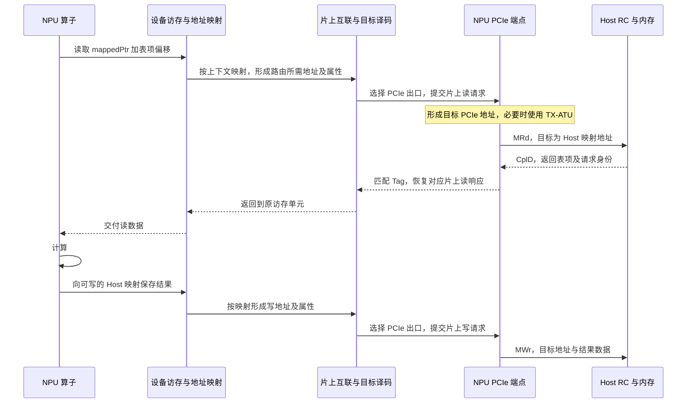

最后两步以算子和映射支持 Host 写为前提。普通 MWr 使用 posted 语义，CPU 消费结果的时机由运行时的完成语义及共享缓冲区同步协议决定。上图的“计算”可使用设备本地资源，因而 Through 的收益取决于实际消除了哪些显式搬运和中间缓冲操作。

#### 2.1.4　BAR、TX-ATU 和 RX-ATU 在哪里

| 位置 | 本场景需要完成的功能 | 应用与驱动的职责 |
|:---|:---|:---|
| NPU 出站侧 | 将算子使用的地址关联到有效的 Host DMA 地址，并发出 MRd/MWr | 应用注册内存并使用返回的指针。若实现依赖 TX-ATU 窗口，由相应运行时或驱动建立；直接出站实现使用已有的地址处理路径。 |
| Host 入站侧 | 把设备请求送到获准访问的 Host 缓冲区 | 平台维护主桥可达范围，启用 IOMMU 时维护对应翻译和权限。主桥窗口与 IOMMU 页映射由不同机制管理。 |
| NPU 完成包接收侧 | 将返回 CplD 匹配到原读操作 | 硬件跟踪请求。无需为返回数据配置 NPU 的 BAR 或反向 RX-ATU 窗口。 |
| NPU 自身 BAR | 对外开放 NPU 的控制或数据资源 | 可用于主机控制设备，但 Through 请求的目标缓冲区位于 Host；该缓冲区的定位依赖 Host 映射。 |

表中的配置关系延续第 1.6 节。公开 Runtime 接口规定的是映射和访问语义，不能由接口名推出 Ascend 某型号的 TX-ATU 寄存器值或固定旁路行为。[CANN 注册接口][cann] · [Linux Endpoint 与 DMA 映射模型][ep]

#### 2.1.5　Embedding 查表与换入换出的应用

设表共有 1,048,576 行，每行 128 个 FP16 元素，总计 256 MiB。若一批只读取 1,024 个不同的行，有效输入是 256 KiB。这个计算给出应用需要的数据量；实际 PCIe 流量还包括协议开销及硬件读取粒度。评估时可以比较“整表上传”“CPU 选出所需行后打包上传”“设备按需读取”三种流程，并把注册、索引处理、同步和计算时间计入端到端结果。重复使用较多的数据也可能适合保存在设备本地。

昇腾 RecSDK 的 `pcie_through` 样例提供了换表应用。Host 侧管理共享队列，`RmaSwapMultiTables` 按换入、换出索引组织传输，核函数按生产者和消费者分工执行搬入、同步与搬出。其所引用分支明确给出 A2、CANN 8.0 及以上等约束。这个样例展示了如何用算子组织共享区访问，其他型号需要使用各自配套的软件与算子实现。[RecSDK 样例说明][rec]

### 2.2　PCIe P2P：访问另一张昇腾卡的板载内存

#### 2.2.1　先确定两张卡的实际互联

本节选择同一台 Host 下两张卡 A、B，经 PCIe Switch 互联的拓扑。A 要访问的数据位于 B 的板载内存。Host 负责分配资源和建立映射，允许本地转发时，请求可经交换机到达 B。若路径跨主桥或 NUMA 节点，P2P 可达性还取决于主机平台及驱动策略。[Linux PCI P2P][p2p]

**图 14　PCIe 组网中 Host 负责配置，卡间承载业务访问**

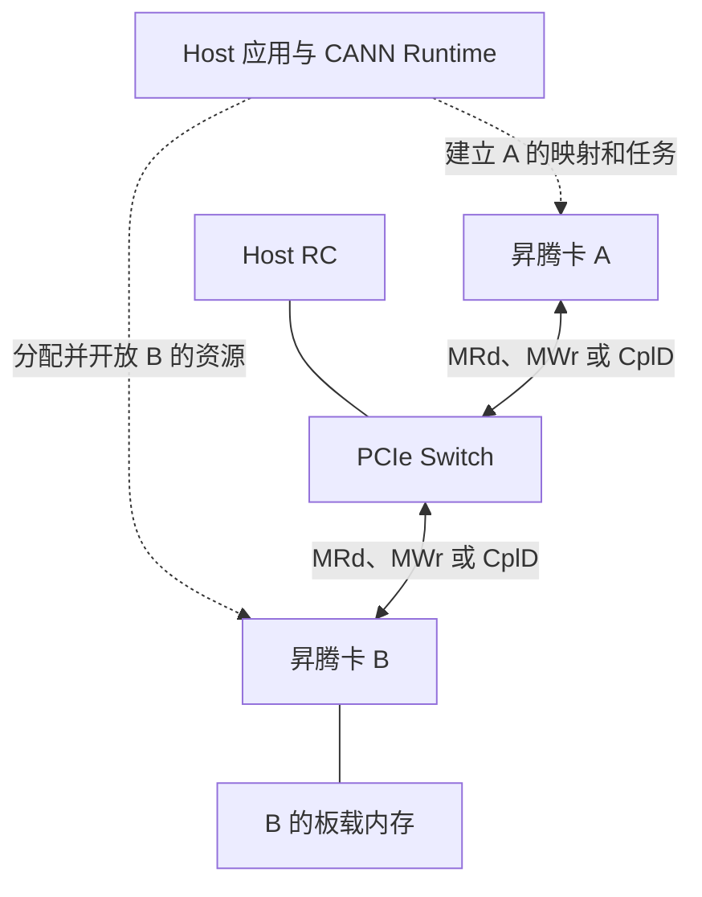

在支持相应命令的产品上，`npu-smi info -t topo` 可以查看拓扑。官方说明中的 PIX 表示经过一个 PCIe Switch，PXB 表示多个 Switch，PHB 表示经过 PCIe 主桥，SYS 表示跨 NUMA 节点，HCCS 表示对应的 HCCS 链路。拓扑标签描述连接关系；还需结合访问使能、实际映射和驱动支持确定可用路径。CANN 的 D2D 接口可服务不同互联，因此一次 D2D 调用成功本身只证明任务成功，不能单凭调用名判定流量走 PCIe。[npu-smi 拓扑命令及标签][asc-topo]

#### 2.2.2　显式 D2D 拷贝的配置流程

以同进程内将 A 的张量复制到 B 为例，应用在各自 Device 上申请合适的缓冲区，等待 A 的生产者完成，再使用 Runtime 提交复制。所用内存分配策略、Device/Context 和流归属，应遵循当前版本的接口约束。

1. 用 `aclrtDeviceCanAccessPeer` 查询两端是否支持相应交互。
2. 在 A 为当前 Device 时调用 `aclrtDeviceEnablePeerAccess(B, 0)`，在 B 为当前 Device 时调用 `aclrtDeviceEnablePeerAccess(A, 0)`。每次使能有方向性，官方双设备传输示例会分别处理两端。
3. 在相应 Context 和流下，用 `aclrtMemcpy` 或 `aclrtMemcpyAsync` 提交 Device-to-Device 拷贝。
4. 等待该复制任务完成，再让 B 的消费者使用目的缓冲区。所有相关操作退出后才可解除映射和释放内存。[CANN 双 Device 传输流程][asc-d2d] · [对等访问使能接口][asc-peer]

双向使能的接口语义属于 Runtime。数据从 A 到 B 的一次复制，底层可能由 A 推送，也可能由 B 拉取，应按真实实现分析请求方向。控制器选择、分包和执行引擎由 Runtime 与设备配合完成。[CANN 数据交互说明][asc-peer]

**图 15　软件上的一次 A 到 B 拷贝，对应两种可实现的数据路径**

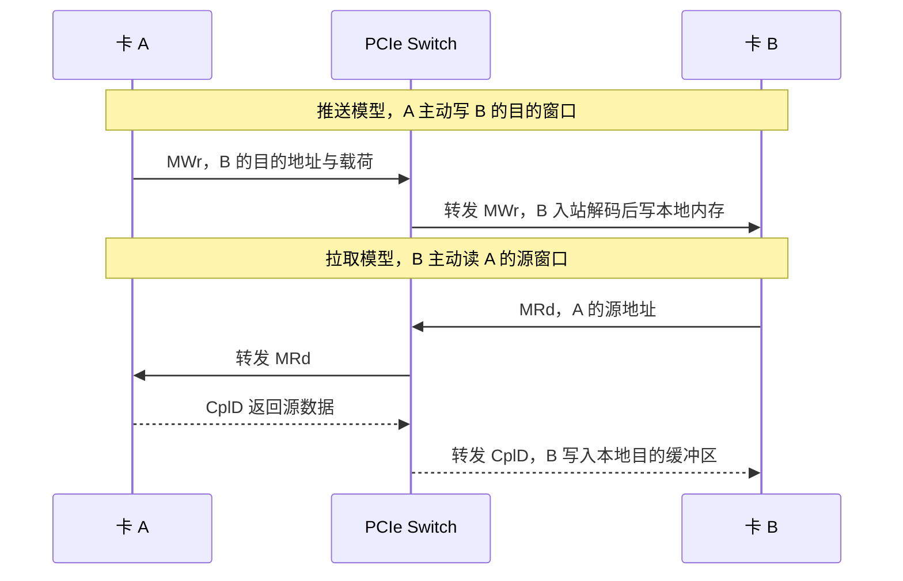

图 15 给出 PCIe 上的两种合法实现模型，应用层 D2D API 未指定必须采用其中哪一种。对于性能分析，若要确认实际引擎和方向，需要将软件任务记录与设备计数器、跟踪或链路抓包对应。

#### 2.2.3　从拷贝扩展到直接共享另一张卡的内存

假设 B 已产生一份张量，A 的算子只需要读取其中少量位置。共享方式保留 B 上的那份存储，并在 A 的访问环境中建立远端映射。A 的算子使用本端有效的共享地址，触发访问 B 的请求。数据读取完成后，算子可在 A 上继续计算。这里还需满足计算单元对共享地址的可达性和指令支持，单纯开放 DMA 引擎的对等通路只解决了拷贝所需的访问能力。

CANN 提供 IPC 共享内存接口。导出进程通过 `aclrtIpcMemGetExportKey` 发布 Device 内存的共享 key，导入进程通过 `aclrtIpcMemImportByKey` 取得自己可用的 Device 地址。官方约束说明还列出了 Cube、Vector 单元跨片访问能力，以及特定产品需要 P2P 内存分配策略等条件。IPC 描述跨进程的映射关系，具体传输链路仍需结合芯片、拓扑和驱动配置确认。[CANN IPC 共享内存导出说明][asc-export]

**图 16　B 的内存导出给 A，计算时由 A 访问**

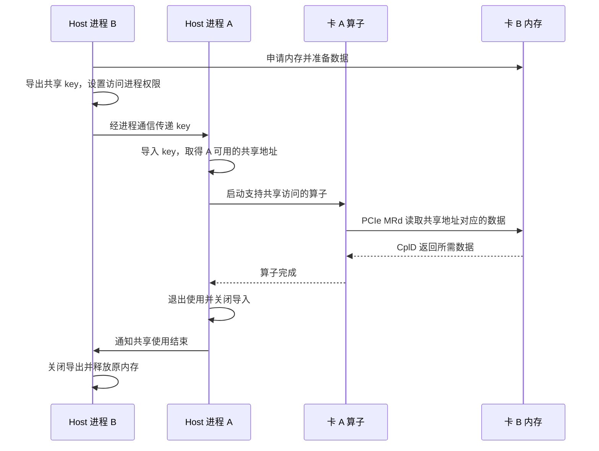

图中采用 PCIe 路径和远端只读消费作为示例。双进程建立关系时，需按产品要求处理 P2P 使能、内存策略及共享 key 权限。导入接口提供单独使能 Peer Access 或按相应导入 flag 开启的选项。原始指针属于导出方的访问环境，导入方使用接口返回的新指针。回收时按导入方先关闭、导出方后关闭并释放的次序执行。[CANN IPC 导入接口][asc-import] · [CANN IPC 导出生命周期][asc-export]

对于 IPC 返回的地址，所引用文档对可用拷贝方向及同步、异步方式另有约束。应用应按该接口的共享内存规则使用它。将 IPC 核侧共享部署在具体 PCIe 机器上，还需确认该型号支持这条链路上的核访问；公开的跨片访问语义本身没有把所有型号的物理链路固定为 PCIe。

#### 2.2.4　P2P 数据流中的 BAR 和 ATU

本例沿用第一章“将目标设备的一段板载内存暴露为 BAR 数据窗口”的地址模型。昇腾应用使用 Runtime 返回的设备指针，底层将其关联到可达的对等资源。实际采用哪个 BAR、窗口大小及内部转换层次属于驱动和硬件实现。下图用教学地址说明在采用 ATU 窗口时所需的映射关系。

**图 17　A 读取 B 时，读请求经过的地址链**


| 操作 | 需要的出站映射 | 目标侧窗口与入站处理 | 返回或完成 |
|:---|:---|:---|:---|
| A 推送数据到 B | A 的请求路径能访问 B 的 peer 地址；窗口实现使用 A 的 TX-ATU | B 的数据 BAR 覆盖目的区，RX-ATU 或等效逻辑指向 B 内存 | posted write 后按传输协议通知完成 |
| B 拉取 A 的数据 | B 的出站路径指向 A 的 peer 地址 | A 的数据 BAR 覆盖源区，A 入站解码定位源数据 | CplD 返回 B，按 Tag 匹配，再写 B 本地目的内存 |
| A 的算子直接读写 B | A 的核侧地址映射及出站路径共同支持共享指针 | B 开放相应资源并完成本地地址解码 | 读用 CplD，写用 MWr；共享数据按生产者、消费者协议同步 |

软件调用 `aclrtDeviceEnablePeerAccess` 或导入共享 key，不等于应用手工填写这些 ATU 寄存器。接口建立受支持的访问关系，具体窗口由底层配置。若控制器直接消费已转换的对等地址，发起侧可使用该路径。目标内存按 BAR 模型暴露时，BAR 解码及入站落点必须与开放资源相符。[Linux P2P 资源模型][p2p] · [Linux Endpoint 映射接口][ep]

#### 2.2.5　两卡流水线的同步

设 B 生产中间结果，A 消费该结果。显式拷贝流程可组织为“B 生产完成 → D2D 复制完成 → A 启动消费者”。共享流程可组织为“B 生产完成并发布 → A 访问 B 的共享区 → A 消费完成 → B 复用该区域”。生产者和消费者之间应使用所选 Runtime、通信库及内存属性支持的完成机制，跨进程还要传递相应完成信号。

共享使得 A 在执行期间仍依赖 B 的缓冲区。若 A 反复读取同一数据，是否提前搬到 A 本地更合适，取决于远端访问次数、PCIe 链路、在途请求数量和数据复用。评价应记录从 B 产出到 A 消费完成的时间，并包括映射建立、通知和回收等实际成本。CPU、DMA 引擎和计算核对同一区域的缓存可见性，也要服从平台定义的同步规则。[Linux DMA 同步说明][dma] · [CANN IPC 生命周期][asc-export]

### 2.3　两种场景的对照

| 维度 | Device 直访 Host | Device 通过 PCIe P2P 访问另一张卡 |
|:---|:---|:---|
| 物理存储归属 | Host DRAM | 对端 Device 的板载内存 |
| 软件开放方式 | Host 内存注册，返回设备侧指针 | Peer Access、D2D 拷贝，或导出与导入共享内存 |
| 读请求 | NPU 发 MRd，主机侧提供数据 | 请求卡发 MRd，目标卡提供数据 |
| 地址终点 | 主机 DMA 地址映射及内存系统 | 对端开放的 PCIe 资源及其板内解码 |
| BAR 的作用 | NPU 自身 BAR 可承担控制访问，Host 目标缓冲区由 DMA 映射定位 | 在 BAR 窗口模型中，目标卡的数据 BAR 定位对等资源 |
| 访问结束的判断 | 算子或任务完成，满足共享缓冲区同步要求 | 拷贝完成，或远端消费者退出共享访问 |
| 实际支持范围 | 型号、注册接口、算子访存及 Host 连接方式 | 两端型号、PCIe 拓扑、驱动、内存策略和访问单元能力 |

### 第二章参考资料

- [CANN Host 内存注册与设备指针][cann]及 [RecSDK PCIe Through 换表实例][rec]。
- [CANN 对等访问使能][asc-peer]及 [双 Device 数据传输示例][asc-d2d]。
- [CANN IPC 导出流程及约束][asc-export]、[IPC 导入指针与 Peer Access 选项][asc-import]。
- [npu-smi 多 NPU 拓扑查询][asc-topo]及 [Linux PCI P2P DMA][p2p]。

[asc-peer]: https://www.hiascend.com/doc_center/source/zh/CANNCommunityEdition/920beta2/API/runtimeapi/aclcppdevg_03_0052.html
[asc-d2d]: https://www.hiascend.com/document/detail/zh/CANNCommunityEdition/82RC1/appdevg/acldevg/aclcppdevg_000013.html
[asc-export]: https://www.hiascend.com/doc_center/source/zh/CANNCommunityEdition/920beta2/API/runtimeapi/aclpythondevg_01_1070.html
[asc-import]: https://www.hiascend.com/doc_center/source/zh/CANNCommunityEdition/910/API/runtimeapi/aclcppdevg_03_1936.html
[asc-topo]: https://www.hiascend.com/doc_center/source/zh/HDK/2610/A2/A2npu/npusmi_0072.html
[sam]: https://developer.arm.com/additional-resources/video-tutorials/amba-chi-system-address-map

[sig]: https://pcisig.com/specification-overview/pci-express-base
[spec]: https://icjj.github.io/icer/document/NCB-PCI_Express_Base_6.2-2024-01-25.pdf
[pci]: https://docs.kernel.org/PCI/pci.html
[dma]: https://docs.kernel.org/core-api/dma-api-howto.html
[mmio]: https://docs.kernel.org/driver-api/device-io.html
[ep]: https://docs.kernel.org/PCI/endpoint/pci-endpoint.html
[p2p]: https://docs.kernel.org/driver-api/pci/p2pdma.html
[command]: https://docs.amd.com/r/en-US/pg054-7series-pcie/Core-Response-to-Command-Register-Settings
[atu]: https://docs.amd.com/r/en-US/am028-versal-gen2-register-reference/PF0_ATU_CAP_IATU_REGION_CTRL_2_OFF_INBOUND_2-MMI_PCIE_CTRL_USP-Register
[qdma]: https://docs.amd.com/r/4.0-English/pg302-qdma/General-Design-of-Queues
[h2c]: https://docs.amd.com/r/en-US/pg302-qdma/H2C-MM-Engine
[c2h]: https://docs.amd.com/r/en-US/pg302-qdma/C2H-MM-Engine
[cann]: https://www.hiascend.com/doc_center/source/zh/CANNCommunityEdition/920beta2/API/runtimeapi/aclpythondevg_01_1066.html
[rec]: https://gitcode.com/Ascend/RecSDK/tree/develop_embcache/cust_op/pcie_through
[xrt]: https://xilinx.github.io/XRT/2025.2/html/p2p.html
